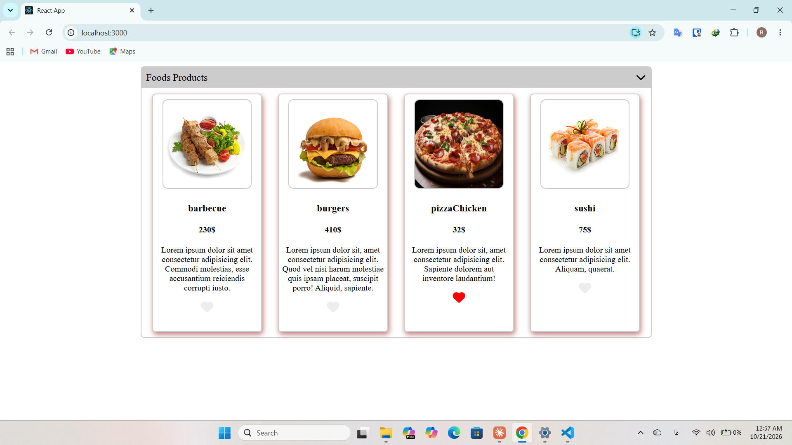

# 🍽️ Foods & Accordion


A collapsible **accordion** that reveals a gallery of **food cards**, each with its own clickable "favorite" heart. Built with **React class components**, **styled-components** and **SCSS**.



## ✨ Features

- **Accordion header** that toggles open/closed, with a color change and a swapping chevron icon
- **Food cards** rendered dynamically from a data array (image, name, price, description)
- **Independent favorite hearts**: every card keeps its own state
- **Hybrid styling**: styled-components for the accordion and heart, SCSS for the food cards

## 🧠 Concepts practiced

| Concept                                                            | Where it's used                                          |
| ------------------------------------------------------------------ | -------------------------------------------------------- |
| Class components & `constructor`                                   | `AccordionBox.js`, `Food.js`, `Foods.js`                 |
| **State** (`this.state` / `setState`)                              | Accordion open/close, per-card heart toggle              |
| **Props** (parent → child)                                         | `Foods` → `Food` (`name`, `img`, `price`, `description`) |
| Rendering lists with `map` and `key`                               | `Foods.js`                                               |
| **Conditional rendering** (`flag && ...`)                          | `AccordionBox.js`                                        |
| Event handling                                                     | `onClick` on the toggle and heart icons                  |
| **styled-components** with props-driven styles                     | `styled_components/StyledAccordion.js`                   |
| **Transient props** (`$flag`) to keep styling props out of the DOM | `HeaderBox`, `Span`, `I1`, `I2`, `HeartIcon`             |
| **SCSS** inside a React project                                    | `styles/food_styles.scss`                                |
| Importing images as modules                                        | `Foods.js`                                               |

## 🔍 How it works

1. `AccordionBox` holds a single boolean state. Clicking the icon flips it.
2. That state is passed to the styled components (`$flag`) to change the header color, text color and visible chevron.
3. When it's `true`, the `Foods` component is rendered.
4. `Foods` maps over the products array and renders one `Food` card per item, passing data down as props.
5. Each `Food` keeps its own boolean state, so liking one card never affects the others.

## 🧰 Tech stack

- React 19
- styled-components 6
- Sass (SCSS)
- Font Awesome (icons)
- Create React App (react-scripts 5)

## 🚀 Getting started

```bash
# install dependencies
npm install

# start the dev server
npm start
```

The app runs at [http://localhost:3000](http://localhost:3000).

| Script          | Description                           |
| --------------- | ------------------------------------- |
| `npm start`     | Runs the app in development mode      |
| `npm run build` | Creates an optimized production build |

## 📁 Project structure

```
src/
├── components/
│   ├── AccordionBox.js          # Accordion with open/close state
│   ├── Foods.js                 # Products data + list rendering
│   ├── Food.js                  # Single food card with favorite heart
│   └── styled_components/
│       └── StyledAccordion.js   # styled-components definitions
├── images/                      # Food images
├── styles/
│   └── food_styles.scss         # Food card styles
├── App.js
└── index.js
```

## 📝 Notes

This exercise was built during my React course to practice component composition, props and state using **class components**, the approach taught in the course. The product text is placeholder (Lorem ipsum).

**Possible improvements**

- Rewrite with function components and hooks (`useState`)
- Move the products data into a separate file or a mock API
- Make the accordion keyboard-accessible (button element, `aria-expanded`)
